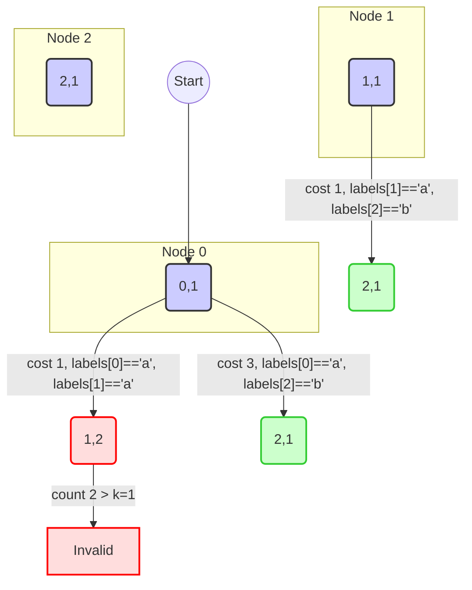

# [3970] Shortest Path With At Most K Consecutive Identical Characters

**Difficulty:** Medium &nbsp;·&nbsp; **Daily Challenge:** 2026-10-30 &nbsp;·&nbsp; [Open on LeetCode](https://leetcode.com/problems/shortest-path-with-at-most-k-consecutive-identical-characters/)

**Topics:** String, Graph Theory, Heap (Priority Queue), Shortest Path

> 🧠 Auto-generated study note. Read it, understand it, then **paste the solution yourself** on LeetCode. Nothing here is auto-submitted.

---

## Original Problem

You are given an integer n representing the number of nodes in a directed weighted graph, numbered from 0 to n - 1. This is represented by a 2D integer array edges, where edges[i] = [u_i, v_i, w_i] represents a directed edge from node u_i to node v_i with weight w_i.

You are also given a string labels of length n, where labels[i] is the character assigned to node i, and an integer k.

Return the minimum total edge weight of a path from node 0 to node n - 1 such that the concatenation of the labels of the nodes along the path contains at most k consecutive identical characters. If no valid path exists, return -1.

Example 1:

Input: n = 3, edges = [[0,1,1],[1,2,1],[0,2,3]], labels = "aab", k = 1

Output: 3

Explanation:

The optimal valid path from node 0 to node 2 is as follows:

- Use edges[2] = [0, 2, 3] to reach node 2 with a weight w_i = 3.

The corresponding concatenation of labels is "ab", which satisfies at most k = 1 consecutive identical characters. Thus, the answer is 3.

Example 2:

Input: n = 3, edges = [[0,1,1],[1,2,1],[0,2,3]], labels = "aab", k = 2

Output: 2

Explanation:

The optimal valid path from node 0 to node 2 is as follows:

- Use edges[0] = [0, 1, 1] to reach node 1 with weight w_i = 1.

- Use edges[1] = [1, 2, 1] to reach node 2 with weight w_i = 1.

The corresponding concatenation of labels is "aab", which satisfies at most k = 2 consecutive identical characters. Thus, the answer is 2.

Example 3:

Input: n = 3, edges = [[0,1,1],[1,2,1]], labels = "aaa", k = 2

Output: -1

Explanation:

There is no valid path from node 0 to node 2 that satisfies at most k = 2 consecutive identical characters. Thus, the answer is -1.

Constraints:

- 1 <= n == labels.length <= 5 * 10^4

- 0 <= edges.length <= 5 * 10^4

- edges[i] == [u_i, v_i, w_i]

- 0 <= u_i, v_i <= n - 1

- u_i != v_i

- 1 <= w_i <= 10^4

- labels consists of lowercase English letters

- 1 <= k <= 50

**Examples / sample tests:**

```
3
[[0,1,1],[1,2,1],[0,2,3]]
"aab"
1
3
[[0,1,1],[1,2,1],[0,2,3]]
"aab"
2
3
[[0,1,1],[1,2,1]]
"aaa"
2
```

---

## Problem Summary
This problem asks for the minimum total edge weight of a path from node 0 to node `n-1` in a directed weighted graph. An additional constraint is that the sequence of node labels along the path must not contain more than `k` consecutive identical characters. If no such path exists, return -1.

## Intuition
This is a **shortest path problem** on a weighted graph. Dijkstra's algorithm is a natural fit for finding shortest paths with non-negative edge weights. However, the path's validity depends not just on the current node, but also on the *sequence of labels leading to it*. Specifically, we need to know the label of the *previous* node and how many times that label has appeared consecutively.

This suggests that the "state" in our shortest path algorithm needs to be more complex than just `(node)`. We need to augment the state to include information about the consecutive character count. A suitable state would be `(current_node, consecutive_count)`, where `consecutive_count` is the number of times `labels[current_node]` has appeared consecutively ending at `current_node`.

When moving from node `u` to node `v`:
*   If `labels[u]` is the same as `labels[v]`, the `consecutive_count` for `v` will be `consecutive_count` of `u` plus 1.
*   If `labels[u]` is different from `labels[v]`, the `consecutive_count` for `v` will reset to 1 (as `labels[v]` starts a new sequence).
*   If the calculated `consecutive_count` for `v` exceeds `k`, then this transition is invalid, and we cannot take this path.

By expanding our states this way, we transform the original graph into a larger "state graph" where each node is `(node_id, consecutive_count)`. Then, we can run standard Dijkstra's algorithm on this expanded state graph.

## Approach
We will use a modified **Dijkstra's algorithm** to find the shortest path in an expanded state space.

1.  **Graph Representation:** First, build an **adjacency list** `adj` where `adj[u]` stores a list of `(v, weight)` tuples for all edges from `u` to `v` with weight `w`.

2.  **State Definition:** Each state in our Dijkstra's will be represented by a tuple `(node, consecutive_count)`. `node` is the current graph node, and `consecutive_count` is how many times `labels[node]` has appeared consecutively at the end of the path leading to `node`. This count can range from 1 to `k`.

3.  **Distance Array:** Initialize a 2D array `dist[n][k+1]` with `float('inf')`. `dist[u][count]` will store the minimum total edge weight to reach `node u` with `count` consecutive identical characters ending at `u`. We use `k+1` size for 1-based indexing of `count`.

4.  **Priority Queue:** Use a min-priority queue (e.g., Python's `heapq`) to store `(current_total_cost, node, consecutive_count)` tuples. The priority queue will always pop the state with the smallest `current_total_cost`.

5.  **Initialization:**
    *   The path starts at node 0. The label `labels[0]` appears 1 time consecutively.
    *   Set `dist[0][1] = 0`.
    *   Push `(0, 0, 1)` (cost, node, consecutive_count) into the priority queue.

6.  **Dijkstra's Loop:**
    *   While the priority queue is not empty:
        *   Pop the state `(current_cost, u, u_count)` with the smallest `current_cost`.
        *   **Optimization:** If `current_cost > dist[u][u_count]`, it means we've already found a shorter path to this state, so skip this entry.
        *   For each neighbor `v` of `u` with edge weight `w` (from `adj[u]`):
            *   Calculate `v_count`:
                *   If `labels[u] == labels[v]`: `v_count = u_count + 1`.
                *   If `labels[u] != labels[v]`: `v_count = 1`.
            *   **Constraint Check:** If `v_count > k`, this transition is invalid. Skip to the next neighbor.
            *   Calculate `new_cost = current_cost + w`.
            *   If `new_cost < dist[v][v_count]`:
                *   Update `dist[v][v_count] = new_cost`.
                *   Push `(new_cost, v, v_count)` into the priority queue.

7.  **Result:** After the Dijkstra's loop finishes, iterate through `dist[n-1][count]` for all `count` from 1 to `k`. The minimum value found among these is the answer. If all values are `float('inf')`, it means node `n-1` is unreachable, so return -1.

## Visualization
Let's visualize the state expansion for a small graph.
Suppose `n=3`, `edges=[[0,1,1],[1,2,1]]`, `labels="aab"`, `k=1`.
Nodes: `0('a')`, `1('a')`, `2('b')`.

Original Graph:
```
0 --(1)--> 1 --(1)--> 2
  (label 'a') (label 'a') (label 'b')
```

Expanded State Graph (relevant states for `k=1`):
Each node is `(node_id, consecutive_count)`.
`dist` values are shown next to states.


*   Initial state: `(0, 0, 1)` (cost 0, node 0, count 1).
*   From `(0,1)`:
    *   To `(1,1)` via `[0,1,1]`: `labels[0]=='a'`, `labels[1]=='a'`. `v_count = u_count + 1 = 1+1=2`. Since `k=1`, `v_count=2 > k=1`, this path is **invalid**.
    *   To `(2,1)` via `[0,2,3]` (if such an edge existed, as in Example 1): `labels[0]=='a'`, `labels[2]=='b'`. `v_count = 1`. Valid. Cost `0+3=3`. State `(3, 2, 1)`.

This diagram shows how the `k` constraint prunes paths. If `labels[u] == labels[v]` and `u_count` is already `k`, then `v_count` would become `k+1`, making the path invalid.

## Dry Run
Let's trace Example 1:
`n = 3, edges = [[0,1,1],[1,2,1],[0,2,3]], labels = "aab", k = 1`
`labels`: `labels[0]='a'`, `labels[1]='a'`, `labels[2]='b'`
`adj = {0: [(1,1), (2,3)], 1: [(2,1)], 2: []}`
`dist = [[inf, inf], [inf, inf], [inf, inf]]` (size `n` x `k+1`)
`pq = []`

| Step | Action | `pq` (cost, node, count) | `dist` changes | Notes |
| :--- | :----- | :----------------------- | :------------- | :---- |
| 1 | Initialize: `dist[0][1] = 0`. Push `(0, 0, 1)`. | `[(0, 0, 1)]` | `dist[0][1]=0` | Start at node 0, count 1. |
| 2 | Pop `(0, 0, 1)`. `u=0, u_count=1`. | `[]` | | `current_cost=0`. |
| 2a | Explore `0 -> 1` (weight 1): `v=1`. | | | `labels[0]='a'`, `labels[1]='a'`. Same. |
| | | | | `v_count = u_count + 1 = 1 + 1 = 2`. |
| | | | | `v_count=2 > k=1`. **Invalid transition.** Skip. |
| 2b | Explore `0 -> 2` (weight 3): `v=2`. | | | `labels[0]='a'`, `labels[2]='b'`. Different. |
| | | | | `v_count = 1`. |
| | | | | `v_count=1 <= k=1`. Valid. |
| | `new_cost = 0 + 3 = 3`. `dist[2][1]=inf`. `3 < inf`. | `[(3, 2, 1)]` | `dist[2][1]=3` | Update `dist`, push to `pq`. |
| 3 | Pop `(3, 2, 1)`. `u=2, u_count=1`. | `[]` | | `current_cost=3`. |
| 3a | Explore neighbors of `u=2`: None. | | | |
| 4 | `pq` is empty. Dijkstra ends. | `[]` | | |
| 5 | Find min cost to `n-1=2`. | | | Check `dist[2][count]` for `count` in `[1, k]`. |
| | `min(dist[2][1]) = min(3) = 3`. | | | |

**Final Result:** 3

## Complexity
*   **Time Complexity:** `O(E * K * log(N * K))`
    *   The number of states in our expanded graph is `N * K` (nodes * max_consecutive_count).
    *   Each original edge `E` can lead to `K` possible transitions in the expanded graph (from `(u, count_u)` to `(v, count_v)`). So, the number of edges in the expanded graph is `O(E * K)`.
    *   Dijkstra's complexity is `O(E_expanded * log(V_expanded))`.
    *   Substituting: `O(E * K * log(N * K))`.
    *   Given `N, E <= 5 * 10^4` and `K <= 50`: `5 * 10^4 * 50 * log(5 * 10^4 * 50) = 2.5 * 10^6 * log(2.5 * 10^6) approx 2.5 * 10^6 * 21`, which is around `5 * 10^7` operations, feasible within typical time limits.
*   **Space Complexity:** `O(N * K)`
    *   For the `dist` array (`N` nodes * `K` counts).
    *   For the priority queue, which can store up to `N * K` states in the worst case.
    *   For the adjacency list, `O(N + E)`.
    *   Dominant factor is `O(N * K)`.

## Edge Cases
*   **`k=1` (strict constraint):** The solution correctly handles this by checking `v_count > k`. If `labels[u] == labels[v]`, `v_count` becomes 2, which is `> k=1`, making the path invalid. This forces paths to alternate labels.
*   **No valid path to `n-1`:** If `n-1` is unreachable or all paths to it violate the `k` constraint, all `dist[n-1][count]` values will remain `float('inf')`. The final check correctly returns -1 in this scenario.
*   **`n=1` (start and end node are the same):** If `n=1`, then `n-1=0`. The path from node 0 to node 0 has a cost of 0. The initial state `dist[0][1] = 0` correctly sets this. Since `u_i != v_i` (no self-loops), no edges will be processed, and the final result will be 0.
*   **Disconnected graph:** If node `n-1` is in a disconnected component from node 0, `dist[n-1][...]` will remain `float('inf')`, leading to a correct -1 return.
*   **Empty `edges` list:** If `edges` is empty and `n > 1`, `n-1` is unreachable, resulting in -1. If `n=1`, it returns 0. Both are correct.
*   **All edge weights are 1:** Dijkstra still works correctly, effectively becoming a BFS on the state graph.

## Solution

```python
import heapq
from collections import defaultdict
from typing import List

class Solution:
    def shortestPath(self, n: int, edges: List[List[int]], labels: str, k: int) -> int:
        # 1. Build adjacency list for the graph
        # adj[u] will store a list of (v, weight) tuples for edges from u to v
        adj = defaultdict(list)
        for u, v, w in edges:
            adj[u].append((v, w))

        # 2. Initialize distance array for our expanded states
        # dist[node][consecutive_count] stores the minimum cost to reach 'node'
        # such that its label has appeared 'consecutive_count' times in a row.
        # consecutive_count ranges from 1 to k. We use k+1 size for 1-based indexing.
        dist = [[float('inf')] * (k + 1) for _ in range(n)]

        # 3. Priority Queue for Dijkstra's algorithm
        # Stores tuples: (current_total_cost, current_node, current_consecutive_count)
        # Python's heapq is a min-priority queue.
        pq = []

        # 4. Initialize the starting state
        # We start at node 0. Its label appears 1 time consecutively (itself).
        # The cost to reach node 0 is 0.
        dist[0][1] = 0
        heapq.heappush(pq, (0, 0, 1))

        # 5. Run Dijkstra's algorithm
        while pq:
            current_total_cost, u, u_consecutive_count = heapq.heappop(pq)

            # If we've already found a shorter path to this exact state (u, u_consecutive_count),
            # we can skip processing this one, as it's suboptimal.
            if current_total_cost > dist[u][u_consecutive_count]:
                continue

            # Explore all outgoing edges from the current node u
            for v, weight in adj[u]:
                v_consecutive_count = 0

                # Determine the consecutive count for the next node v
                if labels[u] == labels[v]:
                    # If labels are the same, increment the count
                    v_consecutive_count = u_consecutive_count + 1
                else:
                    # If labels are different, reset count to 1 for the new label
                    v_consecutive_count = 1

                # Apply the constraint: at most k consecutive identical characters
                if v_consecutive_count > k:
                    continue # This path segment is invalid, do not consider it

                # Calculate the new total cost to reach state (v, v_consecutive_count)
                new_total_cost = current_total_cost + weight

                # If this new path is shorter than any previously found path to (v, v_consecutive_count)
                if new_total_cost < dist[v][v_consecutive_count]:
                    dist[v][v_consecutive_count] = new_total_cost
                    # Add this new, improved path to the priority queue
                    heapq.heappush(pq, (new_total_cost, v, v_consecutive_count))

        # 6. After Dijkstra completes, find the minimum cost to reach the target node (n-1)
        # We need to check all possible valid consecutive counts (1 to k) for node n-1.
        min_path_cost_to_target = float('inf')
        for count in range(1, k + 1):
            min_path_cost_to_target = min(min_path_cost_to_target, dist[n - 1][count])

        # 7. Return the result
        # If min_path_cost_to_target is still infinity, it means node n-1 is unreachable
        # under the given constraints, so return -1. Otherwise, return the found minimum cost.
        return min_path_cost_to_target if min_path_cost_to_target != float('inf') else -1

```

## Why This Works
This solution works because it correctly models the problem as a **shortest path problem on an expanded state graph**. Each "node" in this expanded graph is a pair `(actual_node_id, consecutive_label_count)`. By using Dijkstra's algorithm, which is guaranteed to find the shortest paths in graphs with non-negative edge weights, we systematically explore all valid paths while always prioritizing paths with lower cumulative costs. The `dist` array ensures that we only update a path if a strictly shorter one is found, and the priority queue efficiently retrieves the next most promising state to explore. The `k` constraint is integrated directly into the state transitions, effectively pruning invalid paths from consideration. Finally, by checking all possible valid `consecutive_label_count` values for the target node `n-1`, we ensure we find the overall minimum cost path that satisfies all conditions.

---
<sub>Generated 2026-10-30 06:19 UTC by the Daily LeetCode Explainer (Gemini) • language: Python • not submitted automatically.</sub>
